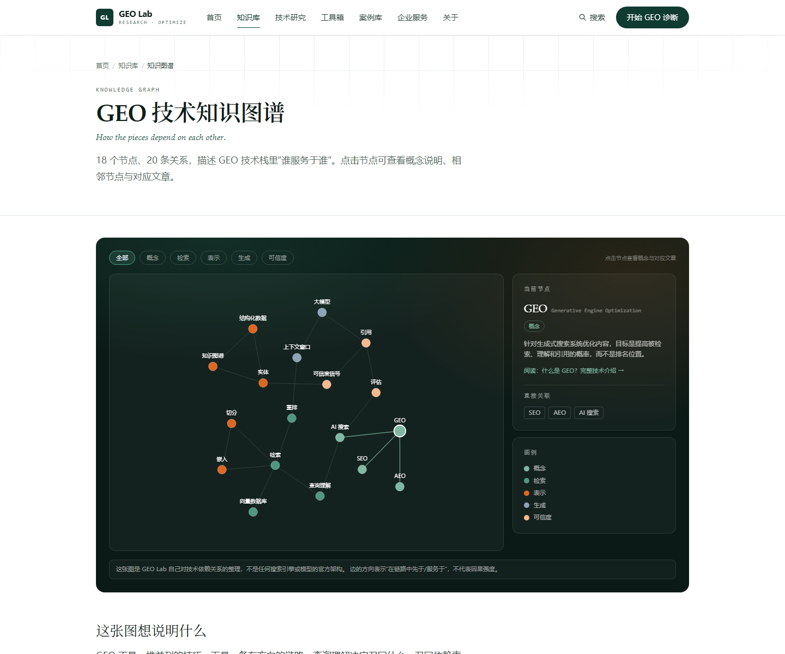
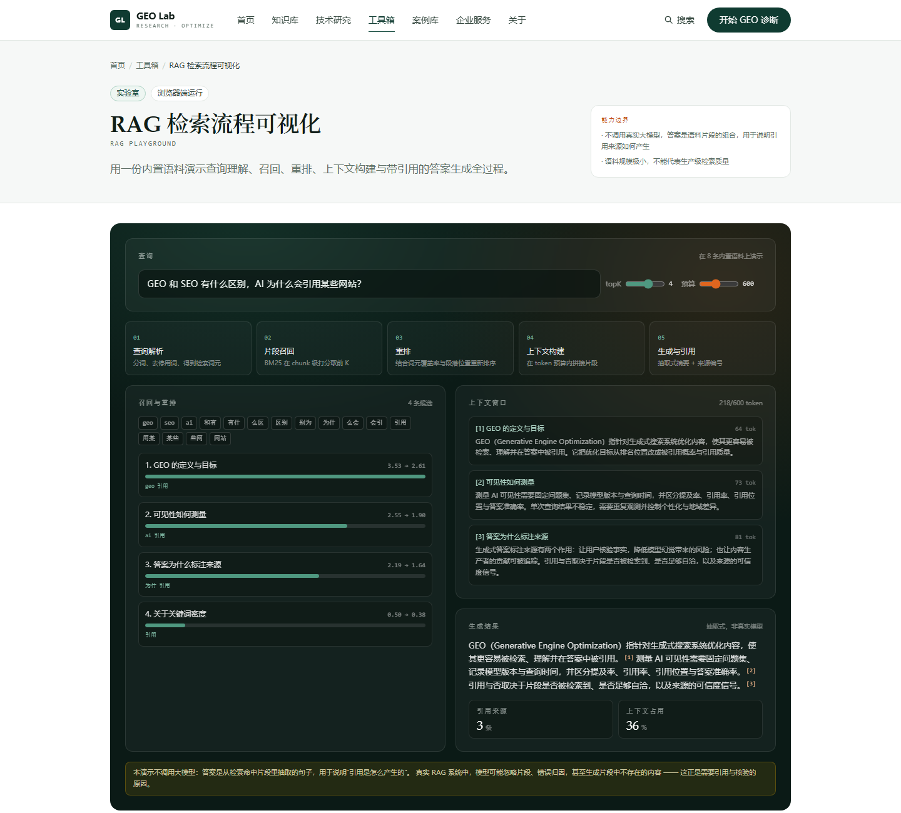
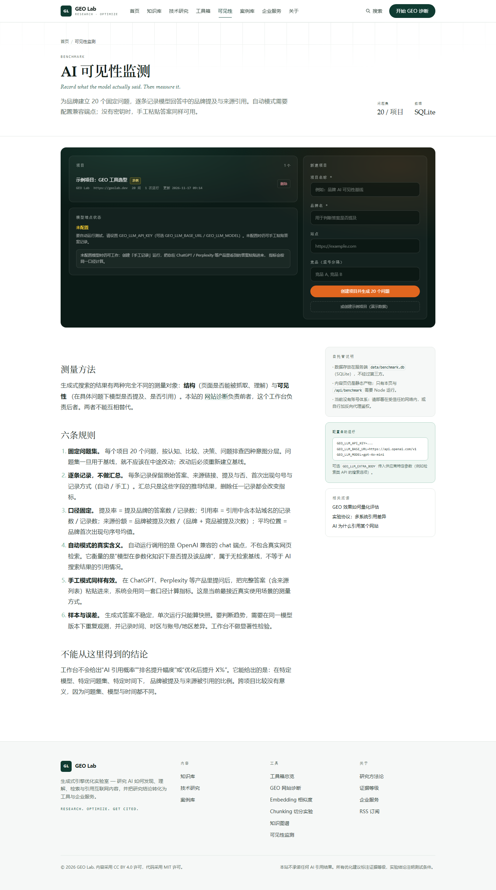
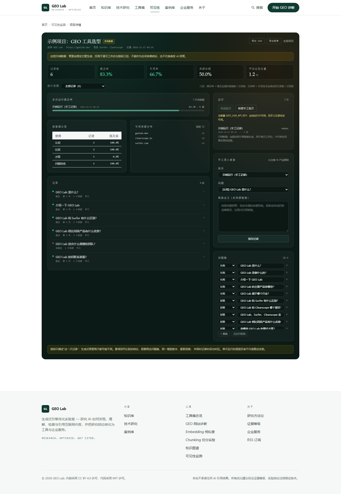
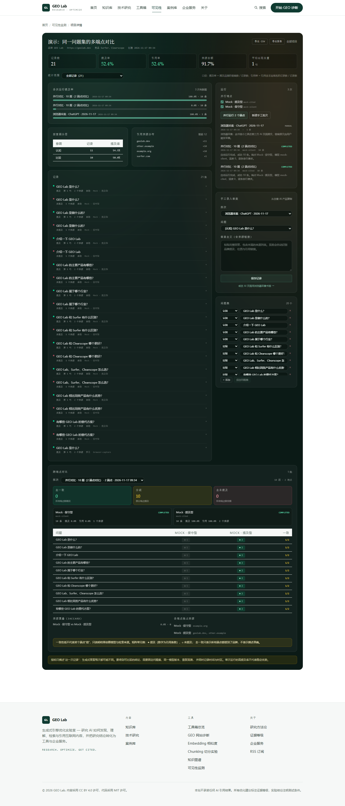
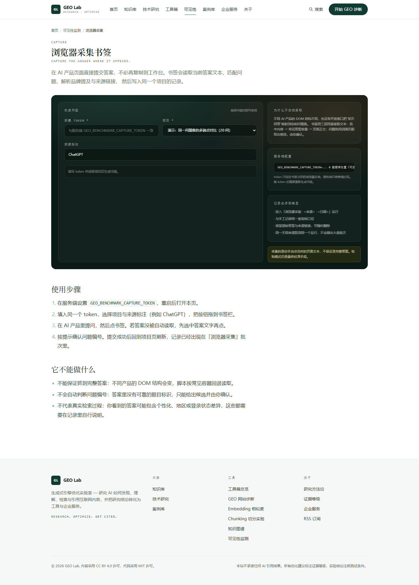
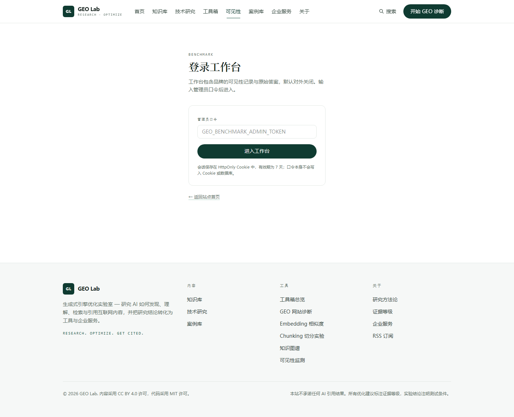

# GEO Lab

**Generative Engine Optimization Laboratory** · 生成式引擎优化实验室

研究 AI 如何发现、理解、检索和引用互联网内容，并把研究结论转化为知识体系、浏览器端实验工具与企业诊断服务。

> Research. Optimize. Get Cited.

---

## 快速开始

```bash
pnpm install
pnpm dev        # http://localhost:4321
pnpm build      # Netlify 适配器构建 + Pagefind 索引
pnpm preview    # netlify dev：本地按 Netlify 的方式跑静态页 + SSR Function
pnpm check      # astro check（TypeScript / Astro 类型检查）
pnpm check:site # 构建产物校验：SEO、JSON-LD、站内链接、内容 frontmatter
pnpm verify     # build + check:site 一条命令
```

Node 版本要求：构建与运行 ≥ 22.13（`node:sqlite` 从该版本起不再需要 `--experimental-sqlite`）。

包管理器使用 pnpm（`pnpm-workspace.yaml` 中显式批准了 `esbuild` 与 `sharp` 的构建脚本）。

## 界面预览

首页（研究机构 + 科技媒体风格：白底、深绿、橙色强调）：


知识图谱（自写力导向 SVG，点击节点查看概念与对应文章）：



RAG 流程实验（BM25 召回 → 重排 → 上下文装配 → 抽取式引用）：



移动端（390px）：


可见性监测工作台（固定问题集 → 逐条记录 → 指标与引用来源）：



项目详情（示例数据，指标、意图分层与引用域名分布）：



多端点一致性矩阵（同一问题集并行跑两个端点，逐题对比提及与引用）：



浏览器采集书签（在 AI 产品页面一键提交答案）：



## 技术栈

| 层 | 选择 | 说明 |
| --- | --- | --- |
| 框架 | Astro 5 | 静态优先，默认输出完整 HTML |
| 语言 | TypeScript（strict） | 内容 frontmatter 由 Zod 校验 |
| 样式 | Tailwind CSS 4 + CSS 变量 | 设计 token 集中在 `src/styles/tokens.css` |
| 交互 | React 19（Islands） | 仅工具与表单水合，其余为纯静态 HTML |
| 内容 | Content Collections + Markdown | 三类集合：knowledge / research / cases |
| 搜索 | Pagefind | 构建后生成索引，纯前端检索 |
| SEO | 自建 `lib/seo` + `lib/schema` | canonical / OG / RSS / JSON-LD / sitemap |
| 部署 | Netlify（`@astrojs/netlify`） | 静态页走 CDN，`/benchmark` 与 `/api` 走 SSR Function |

刻意没有引入的重依赖：Cytoscape（知识图谱用自写力导向 SVG）、ECharts、组件库。基础组件全部是本仓库内的 Astro/React 组件，避免出现第二套设计语言。

## 目录结构

```text
src/
├── components/
│   ├── articles/       ArticleCard
│   ├── common/         面包屑、页头、证据等级徽章
│   ├── home/           首页示意图
│   ├── navigation/     Header / Footer
│   └── seo/            BaseHead（meta + JSON-LD 注入）
├── content/            知识库 / 研究 / 案例（Markdown）
├── features/           交互工具（React Islands，按工具分目录）
│   ├── chunking-lab/   content-analyzer/  embedding-lab/
│   ├── entity-extractor/  knowledge-graph/  rag-playground/
│   ├── schema-generator/  services/  shared/  website-audit/
├── layouts/            MainLayout / ArticleLayout / ToolLayout
├── lib/
│   ├── content/        集合查询与阅读时长
│   ├── schema/         JSON-LD 构造器
│   ├── seo/            站点常量、meta、导航、证据等级
│   ├── tools/          工具注册表（能力 + 边界声明）
│   └── utils/          日期、slug、文本工具
├── pages/              路由
└── styles/             tokens.css / global.css
scripts/check-site.mjs  构建产物与内容校验
```

## 页面

| 路由 | 说明 |
| --- | --- |
| `/` | 首页：定位、四个方向、链路示意、最新内容、方法论、服务入口 |
| `/knowledge/` | 知识库：推荐路径 + 分类浏览 |
| `/knowledge/[slug]/` | 技术文章：目录、证据等级、参考资料、关联工具 |
| `/knowledge/graph/` | 交互式知识图谱（18 节点 / 20 关系） |
| `/research/` | 论文解读、实验报告、技术趋势、开源研究 |
| `/cases/` | 案例库，按检查范围标注（结构 / 内容 / 可见性） |
| `/tools/` | 工具箱总览 |
| `/tools/site-audit/` | GEO 网站诊断（粘贴 HTML 或自建抓取端点） |
| `/tools/embedding/` | 语义相似度：哈希向量 + 余弦相似度 |
| `/tools/chunking/` | 四种切分策略并排对比 |
| `/tools/rag/` | BM25 召回 → 重排 → 上下文 → 抽取式引用 |
| `/tools/entity/` | 实体提取与实体覆盖检查 |
| `/tools/schema/` | JSON-LD 生成 + 校验提示 |
| `/tools/content-structure/` | 内容结构评分与改进清单 |
| `/services/` | 四个服务阶段、计价说明、需求表单（本机 mailto） |
| `/benchmark/` | AI 可见性监测工作台（按需渲染，见下） |
| `/about/` | 研究方法论、证据分级、技术实现 |
| `/search/` | Pagefind 站内搜索 |
| `/rss.xml`、`/robots.txt`、`/sitemap-index.xml` | 订阅与抓取声明 |

## 可见性监测工作台（V2）

`/benchmark/` 与 `/api/benchmark/*` 是站点里唯一按需渲染（服务端）的部分。数据存放在 SQLite，不经过第三方：本地默认 `data/benchmark.db`，Netlify 上写入函数实例的 `/tmp/benchmark.db`。

**能做什么**

- 为品牌建立固定问题集（默认 20 题，按认知 / 比较 / 决策 / 问题排查分层）
- 自动运行：调用 OpenAI 兼容的 `/chat/completions` 逐题记录答案、品牌提及与来源链接
- **多端点并行对比**：同一问题集同时发给最多 4 个端点（端点之间并行、单端点内串行），输出一致性矩阵
- **浏览器采集书签**：在 ChatGPT / Perplexity 页面上点一下，把答案提交回工作台（CORS + token）
- 手工记录：把完整回答粘贴进来，按同一口径计算
- 指标：提及率、引用率、来源份额、平均出现句序、意图分层、引用域名分布
- 一致性：全一致 / 分歧 / 全未提及、来源重叠（Jaccard）、各端点独占来源
- 导出 CSV（含 BOM，Excel 可直接打开）与 Markdown 报告
- 示例项目：没有密钥也能看到完整工作台（标记为「示例数据」，不可作为结论）

**端点配置**

端点存在数据库里，但**只存密钥的环境变量名**，不存密钥本身：

| 字段 | 说明 |
| --- | --- |
| Base URL | 任意 OpenAI 兼容端点，例如 `https://api.perplexity.ai`、自建网关 |
| 模型 | `sonar-pro`、`gpt-4o-mini`、本地模型名 |
| 密钥环境变量名 | 例如 `OPENAI_API_KEY`；留空表示自建网关/本地模型不需要鉴权 |
| 额外请求体 | JSON，透传给供应商（如搜索范围、工具参数） |

一个端点配置示例（界面里填写，环境变量另行设置）：

```bash
OPENAI_API_KEY=sk-...      # 与端点配置里的环境变量名一致
PERPLEXITY_API_KEY=pplx-...
```

**浏览器采集**

```bash
GEO_BENCHMARK_CAPTURE_TOKEN=<随机字符串>   # 不设置则采集接口返回 403
```

打开 `/benchmark/capture/`，填入同一个 token，把生成的按钮拖到书签栏。在 AI 产品页面点书签后：
先请求候选问题（词面匹配，不调用模型）→ 你确认编号 → 写入「浏览器采集 · \<来源\> · \<日期\>」批次。

**访问控制（公网部署必开）**

```bash
GEO_BENCHMARK_ADMIN_TOKEN=<随机口令>   # 不设置则工作台完全开放
```

- 保护范围：`/benchmark/*` 页面与 `/api/benchmark/*` 数据接口
- 登录页 `/benchmark/login`：口令换 HttpOnly 会话 Cookie（HMAC 派生，7 天，`SameSite=Lax`）；口令本身不写 Cookie、不进数据库
- 采集接口（`/api/benchmark/capture/*`）保持公开，用它自己的 token + CORS 鉴权——书签运行在第三方页面，无法携带 Cookie
- 脚本与 CI 可用请求头 `x-geo-admin-token` 免登录（测试脚本即用这个方式）
- 未设置时行为与之前一致（本地开发无需登录），页面右上角会标注「未启用访问控制」



**配置默认端点（不建端点时仍可用）**

```bash
GEO_LLM_API_KEY=sk-...
GEO_LLM_BASE_URL=https://api.openai.com/v1   # 任意兼容端点，含自建网关
GEO_LLM_MODEL=gpt-4o-mini
GEO_LLM_EXTRA_BODY={"temperature":0}          # 可选：供应商特定参数
```

未配置密钥时自动运行返回 400 并给出提示；手工记录与书签采集仍然可用。

**运行方式**

```bash
pnpm build                       # 产出 dist/（静态页）与 .netlify/v1/functions/ssr（按需路由）
pnpm preview                     # netlify dev，本地验证静态页 + SSR Function
pnpm dev                         # 或直接用 astro dev（API 同样可用）

# 端到端测试：需要 dev server 处于运行状态
GEO_BENCHMARK_CAPTURE_TOKEN=test-capture-token GEO_BENCHMARK_ADMIN_TOKEN=test-admin-token pnpm dev
GEO_TEST_CAPTURE_TOKEN=test-capture-token GEO_TEST_ADMIN_TOKEN=test-admin-token \
  node scripts/test-benchmark.mjs http://localhost:4321
```

省略 `GEO_TEST_ADMIN_TOKEN` 时鉴权断言会跳过（服务端也没开鉴权的情况下测试依然全绿）。

测试会自行启动 `scripts/mock-llm.mjs`（端口 4399）来验证并行调度与一致性矩阵，不消耗真实模型额度。
`pnpm benchmark:reset` 清空本地监测数据库（需确认）。

**能力边界**

- 自动模式只调用 chat 端点，**不包含真实网页检索**：它衡量的是“模型在参数化知识下是否提及该品牌”，属于无检索基线，不等于 AI 搜索结果中的引用情况。要测后者，请用手工记录或书签采集，或把端点指向带检索能力的 API（如搜索类模型）。
- 一致性矩阵不判断谁对：分歧只说明结果依赖模型与来源。
- 书签读取的是点击时的页面文本，不同产品的 DOM 会变，读取失败时先选中答案再点。
- 没有账号体系，请部署在可信网络内或自行加反向代理鉴权。
- 不做显著性检验。单次运行只是快照，趋势需要重复观测。

## 部署（Netlify）

仓库自带 `netlify.toml`：Git 仓库连到 Netlify 后，推送到 `main` 即按配置自动构建。

- 构建命令 `pnpm run build`，发布目录 `dist`
- `NODE_VERSION = "22"`：`node:sqlite` 需要 Node ≥ 22.13
- `SITE_URL` 决定 canonical / sitemap / JSON-LD 里的绝对地址，换域名只改这一处（模板默认 `https://geo-lab-site.netlify.app`）

产物结构（`@astrojs/netlify`）：

```text
dist/                        预渲染页面、_astro 资源、pagefind 索引、404.html
.netlify/v1/functions/ssr/   /benchmark/* 与 /api/benchmark/* 的按需渲染 Function
```

> 之前整站 404 的原因：项目用的是 `@astrojs/node` standalone 适配器，静态文件在 `dist/client`、
> 服务端在 `dist/server`，而 Netlify 发布的是 `dist/`。根目录没有 `index.html`，于是每个路径都落到
> Netlify 自己的 404 页面。换成 Netlify 适配器后静态页回到 `dist/` 根目录，问题消失。

**数据持久化**：Netlify Function 只有 `/tmp` 可写，且实例回收即清空。可见性监测的数据在 Netlify 上
属于「单次实例内有效」——创建项目、记录、导出都能用，冷启动后不保证还在。需要长期保存请接
Netlify Blobs 或外部数据库（Turso / Postgres），或把工作台单独部署到带持久磁盘的 Node 主机。

## 设计约束（写进代码里）

1. **证据等级**：每篇内容必须声明 `evidence`（`official` / `paper` / `experiment` / `analysis` / `field`），`about` 页给出分级标准。
2. **结构 vs 可见性**：网站诊断只报告静态结构；AI 可见性必须由固定问题集的测试观测。工具页与案例页都显式写明这一点。
3. **能力边界**：`src/lib/tools/registry.ts` 中每个工具都必须写 `limitations`，工具页把它们放在首屏。
4. **不虚构数据**：案例中的演示站点标注为演示；实验协议标注"结果将另行发布"。
5. **内容校验**：`pnpm check:site` 会检查 title/description/canonical、JSON-LD 可解析、站内链接可达、frontmatter 取值合法。

## 已知边界

- **表单没有后端**：`/services/` 的需求表单在本机生成邮件草稿（不经过服务器）。
- **网站诊断的远程抓取**：浏览器同源策略不允许直接读取他人站点 HTML，因此远程模式需要自建端点（`POST { url } → { html, status, headers }`）；粘贴 HTML 模式完全离线可用。
- **工具是教学实现**：Embedding 工具使用哈希向量而非神经嵌入模型；RAG 工具使用抽取式摘要而非大模型。两者都在页面上明确标注。
- **单语**：当前只有中文，内容集合已带 `lang` 字段与 `hreflang` 位置预留，双语需要新增 `en` 集合与路由。
- **Pagefind 索引**：`pnpm dev` 下搜索不可用（索引在 `pnpm build` 之后生成）。

## 后续路线

1. Robots / Sitemap 分析器与抓取服务（需要服务端）。
2. 可见性测试工作台：固定问题集 + 多模型记录 + 引用追踪（V2 GEO Benchmark）。
3. 报告导出（Markdown / PDF）。
4. 中英双语路由与内容。
5. 自动化：CI 中运行 `pnpm verify`，并加入 Lighthouse 预算。

## 许可

内容 CC BY 4.0，代码 MIT。
