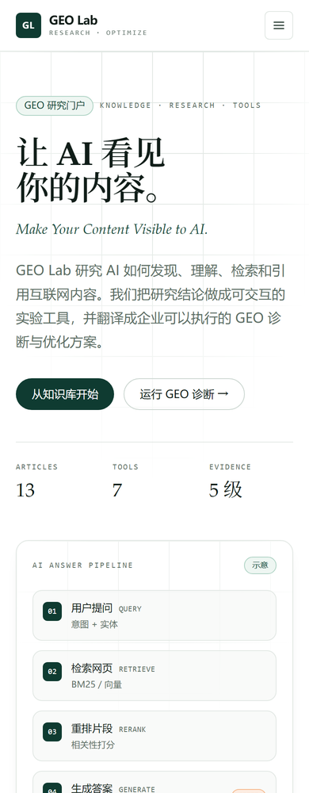

# GEO Lab

**Generative Engine Optimization Laboratory** · 生成式引擎优化实验室

研究 AI 如何发现、理解、检索和引用互联网内容，并把研究结论转化为知识体系、浏览器端实验工具与企业诊断服务。

> Research. Optimize. Get Cited.

---

## 快速开始

```bash
pnpm install
pnpm dev        # http://localhost:4321
pnpm build      # 静态构建 + Pagefind 索引
pnpm preview    # 预览构建产物
pnpm check      # astro check（TypeScript / Astro 类型检查）
pnpm check:site # 构建产物校验：SEO、JSON-LD、站内链接、内容 frontmatter
pnpm verify     # build + check:site 一条命令
```

Node ≥ 20。包管理器使用 pnpm（`pnpm-workspace.yaml` 中显式批准了 `esbuild` 与 `sharp` 的构建脚本）。

## 界面预览

首页（研究机构 + 科技媒体风格：白底、深绿、橙色强调）：


知识图谱（自写力导向 SVG，点击节点查看概念与对应文章）：


RAG 流程实验（BM25 召回 → 重排 → 上下文装配 → 抽取式引用）：


移动端（390px）：



## 技术栈

| 层 | 选择 | 说明 |
| --- | --- | --- |
| 框架 | Astro 5 | 静态优先，默认输出完整 HTML |
| 语言 | TypeScript（strict） | 内容 frontmatter 由 Zod 校验 |
| 样式 | Tailwind CSS 4 + CSS 变量 | 设计 token 集中在 `src/styles/tokens.css` |
| 交互 | React 19（Islands） | 仅工具与表单水合，其余为纯静态 HTML |
| 内容 | Content Collections + Markdown | 三类集合：knowledge / research / cases |
| 搜索 | Pagefind | 构建后生成索引，纯前端检索 |
| SEO | 自建 `lib/seo` + `lib/schema` | canonical / OG / RSS / JSON-LD / sitemap |

刻意没有引入的重依赖：Cytoscape（知识图谱用自写力导向 SVG）、ECharts、组件库。基础组件全部是本仓库内的 Astro/React 组件，避免出现第二套设计语言。

## 目录结构

```text
src/
├── components/
│   ├── articles/       ArticleCard
│   ├── common/         面包屑、页头、证据等级徽章
│   ├── home/           首页示意图
│   ├── navigation/     Header / Footer
│   └── seo/            BaseHead（meta + JSON-LD 注入）
├── content/            知识库 / 研究 / 案例（Markdown）
├── features/           交互工具（React Islands，按工具分目录）
│   ├── chunking-lab/   content-analyzer/  embedding-lab/
│   ├── entity-extractor/  knowledge-graph/  rag-playground/
│   ├── schema-generator/  services/  shared/  website-audit/
├── layouts/            MainLayout / ArticleLayout / ToolLayout
├── lib/
│   ├── content/        集合查询与阅读时长
│   ├── schema/         JSON-LD 构造器
│   ├── seo/            站点常量、meta、导航、证据等级
│   ├── tools/          工具注册表（能力 + 边界声明）
│   └── utils/          日期、slug、文本工具
├── pages/              路由
└── styles/             tokens.css / global.css
scripts/check-site.mjs  构建产物与内容校验
```

## 页面

| 路由 | 说明 |
| --- | --- |
| `/` | 首页：定位、四个方向、链路示意、最新内容、方法论、服务入口 |
| `/knowledge/` | 知识库：推荐路径 + 分类浏览 |
| `/knowledge/[slug]/` | 技术文章：目录、证据等级、参考资料、关联工具 |
| `/knowledge/graph/` | 交互式知识图谱（18 节点 / 20 关系） |
| `/research/` | 论文解读、实验报告、技术趋势、开源研究 |
| `/cases/` | 案例库，按检查范围标注（结构 / 内容 / 可见性） |
| `/tools/` | 工具箱总览 |
| `/tools/site-audit/` | GEO 网站诊断（粘贴 HTML 或自建抓取端点） |
| `/tools/embedding/` | 语义相似度：哈希向量 + 余弦相似度 |
| `/tools/chunking/` | 四种切分策略并排对比 |
| `/tools/rag/` | BM25 召回 → 重排 → 上下文 → 抽取式引用 |
| `/tools/entity/` | 实体提取与实体覆盖检查 |
| `/tools/schema/` | JSON-LD 生成 + 校验提示 |
| `/tools/content-structure/` | 内容结构评分与改进清单 |
| `/services/` | 四个服务阶段、计价说明、需求表单（本机 mailto） |
| `/about/` | 研究方法论、证据分级、技术实现 |
| `/search/` | Pagefind 站内搜索 |
| `/rss.xml`、`/robots.txt`、`/sitemap-index.xml` | 订阅与抓取声明 |

## 设计约束（写进代码里）

1. **证据等级**：每篇内容必须声明 `evidence`（`official` / `paper` / `experiment` / `analysis` / `field`），`about` 页给出分级标准。
2. **结构 vs 可见性**：网站诊断只报告静态结构；AI 可见性必须由固定问题集的测试观测。工具页与案例页都显式写明这一点。
3. **能力边界**：`src/lib/tools/registry.ts` 中每个工具都必须写 `limitations`，工具页把它们放在首屏。
4. **不虚构数据**：案例中的演示站点标注为演示；实验协议标注"结果将另行发布"。
5. **内容校验**：`pnpm check:site` 会检查 title/description/canonical、JSON-LD 可解析、站内链接可达、frontmatter 取值合法。

## 已知边界

- **表单没有后端**：`/services/` 的需求表单在本机生成邮件草稿（不经过服务器）。
- **网站诊断的远程抓取**：浏览器同源策略不允许直接读取他人站点 HTML，因此远程模式需要自建端点（`POST { url } → { html, status, headers }`）；粘贴 HTML 模式完全离线可用。
- **工具是教学实现**：Embedding 工具使用哈希向量而非神经嵌入模型；RAG 工具使用抽取式摘要而非大模型。两者都在页面上明确标注。
- **单语**：当前只有中文，内容集合已带 `lang` 字段与 `hreflang` 位置预留，双语需要新增 `en` 集合与路由。
- **Pagefind 索引**：`pnpm dev` 下搜索不可用（索引在 `pnpm build` 之后生成）。

## 后续路线

1. Robots / Sitemap 分析器与抓取服务（需要服务端）。
2. 可见性测试工作台：固定问题集 + 多模型记录 + 引用追踪（V2 GEO Benchmark）。
3. 报告导出（Markdown / PDF）。
4. 中英双语路由与内容。
5. 自动化：CI 中运行 `pnpm verify`，并加入 Lighthouse 预算。

## 许可

内容 CC BY 4.0，代码 MIT。
